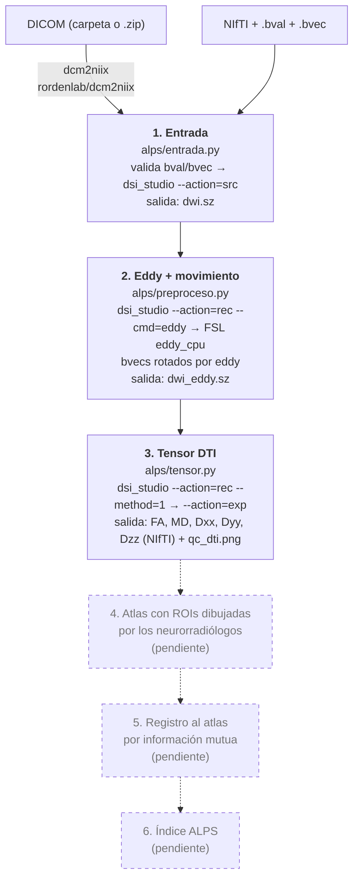

# Pipeline: fases, herramientas y fuentes

Diagrama vivo del proyecto: se actualiza cada vez que se implementa o cambia una fase.
El detalle de cada decisión, con su alternativa descartada, está en [`decisiones.md`](decisiones.md).

 Pasos 1-3 implementados; pasos 4-6 pendientes.

## Fases implementadas

| Fase | Qué hace | Herramienta y versión | Fuente | Archivo del proyecto |
|---|---|---|---|---|
| 1. Entrada | DICOM → NIfTI + .bval + .bvec | dcm2niix (paquete pip `dcm2niix`, versión en `requirements.txt`) | https://github.com/rordenlab/dcm2niix | `alps/entrada.py` |
| 1. Entrada | Exige .bval y .bvec (el NIfTI no los guarda) y valida que coincidan con los volúmenes | Python | Formato FSL/BIDS de bval/bvec; DSI Studio solo advierte si faltan (verificado) | `alps/entrada.py` |
| 1. Entrada | Crea el archivo fuente `dwi.sz` | DSI Studio 2026.7.25 `--action=src` |
| 2. Eddy + movimiento | DSI Studio escribe el DWI en formato FSL, corre eddy (`--acqp 0 -1 0 0.05`, máscara U-Net, sin TOPUP) y recarga el DWI corregido con los bvecs rotados → `dwi_eddy.sz` | DSI Studio 2026.7.25 `--action=rec --cmd=eddy+save_src=…`; FSL 6.0.7.23 `eddy_cpu` | https://dsi-studio.labsolver.org/doc/cli_t2.html; código `run_eddy` / `load_topup_eddy_result` en https://github.com/frankyeh/DSI-Studio/blob/master/libs/dsi/image_model.cpp; https://fsl.fmrib.ox.ac.uk/fsl/docs/diffusion/eddy/users_guide/index.html; Marín et al. 2025 | `alps/preproceso.py` |
| 3. Tensor DTI | Ajuste del tensor y mapas FA, MD, txx/tyy/tzz | DSI Studio 2026.7.25 `--action=rec --method=1 --other_output=md,tensor` | https://dsi-studio.labsolver.org/doc/cli_t2.html | `alps/tensor.py` |
| 3. Tensor DTI | Exporta los mapas a NIfTI | DSI Studio `--action=exp --export=fa,md,txx,tyy,tzz` | https://dsi-studio.labsolver.org/doc/cli_exp.html | `alps/tensor.py` |

Todas las llamadas a DSI Studio pasan por `alps/dsi_studio.py`, que deja el comando exacto y su salida en `dsi_studio.log`,
dentro de la carpeta de cada sujeto.

## Plataforma

DSI Studio corre nativo en Linux, macOS y Windows. FSL corre en Linux y macOS, y en Windows solo dentro de WSL
. Por eso el desarrollo se hace en WSL2 Ubuntu.

