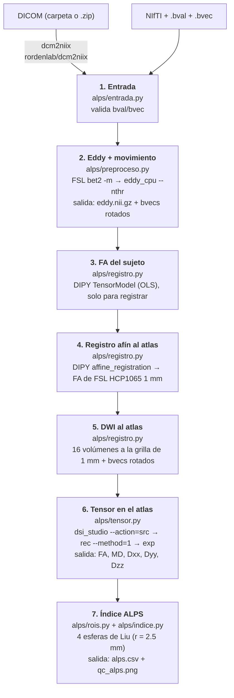

# Pipeline: fases, herramientas y fuentes

Diagrama vivo del proyecto: se actualiza cada vez que se implementa o cambia una fase.
El detalle de cada decisión, con su alternativa descartada, está en [`decisiones.md`](decisiones.md).

Pipeline completo (estructura acordada con la prof. Chabert, reuniones del 2026-11-03 y 2026-11-17). El tensor se
calcula **después** del registro, para que Dxx, Dyy y Dzz queden en los ejes del atlas.

## Fases

| Fase | Qué hace | Herramienta | Fuente | Archivo |
|---|---|---|---|---|
| 1. Entrada | DICOM → NIfTI + .bval + .bvec; exige bval/bvec (el NIfTI no los guarda) y valida que coincidan | dcm2niix; Python | https://github.com/rordenlab/dcm2niix; DSI Studio solo advierte si faltan (verificado) | `alps/entrada.py` |
| 2. Eddy + movimiento | Máscara `bet2 -m` del b0; `eddy_cpu` con los parámetros que usaba DSI Studio más `--nthr`; `--acqp 0 1 0 0.1` (SUPUESTO) | FSL `bet2`, `eddy_cpu` | https://fsl.fmrib.ox.ac.uk/fsl/docs/diffusion/eddy/users_guide/index.html; gbarisano/alps (alps.sh); Marín et al. 2025 | `alps/preproceso.py` |
| 3. FA del sujeto | Tensor OLS solo para tener el FA que guía el registro | DIPY `TensorModel` | alps.sh (registra el FA de dtifit) | `alps/registro.py` |
| 4. Registro | Afín 12 gdl, información mutua, FA sujeto → FA de FSL HCP1065 1 mm (grilla MNI) | DIPY `affine_registration` | Liu et al. 2024; alps.sh (`flirt -dof 12`); tutorial de DIPY | `alps/registro.py` |
| 5. DWI al atlas | Cada volumen a la grilla del atlas (lineal); bvecs rotados con la parte rotacional (polar) de la matriz | DIPY `AffineMap`; NumPy | Leemans & Jones 2009; Alexander et al. 2001; convención de bvecs FSL (MRtrix3) | `alps/registro.py` |
| 6. Tensor en el atlas | DTI sobre el DWI en el atlas, sin remuestrear (`--make_isotropic=0`); exporta FA, MD, txx, tyy, tzz | DSI Studio 2026.7.25 | https://dsi-studio.labsolver.org/doc/cli_t2.html; cli_exp.html; Marín et al. 2025 | `alps/tensor.py` |
| 7. ALPS | Medias de Dxx, Dyy, Dzz en las esferas de Liu; ALPS por hemisferio y promedio | NumPy | Taoka et al. 2017; Liu et al. 2024; gbarisano/alps | `alps/rois.py`, `alps/indice.py` |

Cada sujeto deja `fsl.log` y `dsi_studio.log` con el comando exacto de cada llamada, e `informe.md` con el detalle de
cada paso (también se ve en la app).

## Plataforma e instalación

Corre en macOS (Apple Silicon o Intel) y Linux; en Windows, dentro de WSL2. `app/instalar.sh` instala lo mínimo en
`herramientas/`: micromamba, un entorno con Python, otro aparte con solo los paquetes de FSL que se usan (`fsl-eddy`, `fsl-bet2`,
`fsl-data_standard`, `fsl-data_atlases`) y DSI Studio. `app/abrir_app.command` abre la app.
